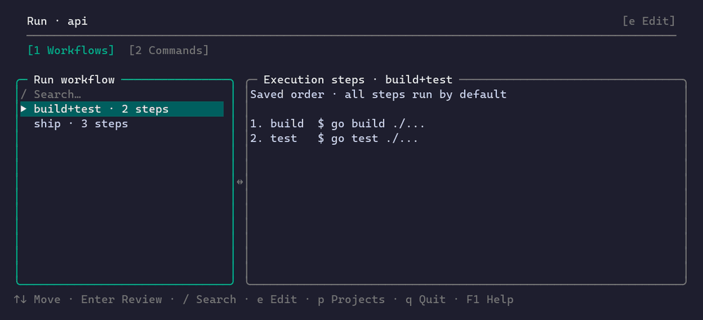
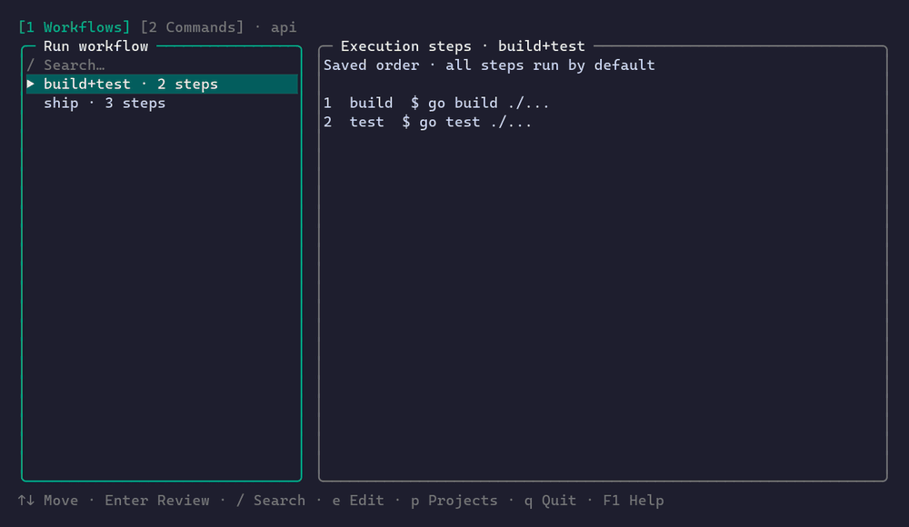

# baton

[](https://github.com/Taka-S-dev/baton/actions/workflows/ci.yml)
[](https://github.com/Taka-S-dev/baton/actions/workflows/release.yml)

```
  _           _
 | |__   __ _| |_ ___  _ __
 | '_ \ / _` | __/ _ \| '_ \
 | |_) | (_| | || (_) | | | |
 |_.__/ \__,_|\__\___/|_| |_|
```

A per-project command palette for the terminal. Commands live in a
plain TSV or JSON file, `{placeholders}` are filled from lists at run
time, and sequences are saved as workflows. Windows (cmd / PowerShell),
Linux and macOS behave the same.



```
[1 Workflows] [2 Commands] · api
Select commands · 2 selected                       │ Run queue · 2 selected
/ Search…                    4/4 · Name ↑ · s Sort │   1. build  $ go build ./...
  [1] build                                        │   2. test  $ go test ./...
  [ ] deploy                                       │
  [ ] logs                                         │
▶ [2] test                                         │
```

Open a project, pick commands in order, review, run. The project editor
(`e`) is where commands, workflows, lists and variables are written —
or write the TSV by hand; both work.

## What baton does not do

- **No build graph.** No dependencies, conditions or loops between
  steps. A workflow is a list of commands run in order; use `just`,
  `make` or `task` for anything that needs a graph.
- **No daemon or remote execution.** Commands run in the foreground
  of the terminal baton was started in, with their output live. Scripts
  and agents have two entry points, `baton check` and the local
  [JSON API](docs/agent-api.md); each is one process that exits.
- **No cross-project workflows.** A workflow belongs to one project; a
  project is one folder. (`baton r` can queue recent commands from
  several projects for one run, each with its own variables.)
- **No shell history.** The recent-command launcher stores which
  saved command ran in which directory, never the resolved command
  line or the values typed into it.
- **No plugins.** Behaviour is fixed; extension is by editing the
  project files, by hand or through the JSON API, which writes the
  same files.

## Install

Download a binary from the [Releases](../../releases) page, or build
from source with Go 1.24+:

```
go build -o baton .
```

## Thirty seconds

```
cp -r projects.example projects         # Linux/macOS
xcopy projects.example projects /E /I   # Windows
baton
```

baton looks for `projects/` next to the executable, then in
`~/.config/baton/projects/`, or wherever `$BATON_PROJECTS_DIR` points.
Each subfolder is a project; `commands.tsv` is its only required file:

```
name	group	workdir	cmd	shell	slots
build	make		go build ./...
deploy	deploy		deploy --env {env} --dir {$root}
```

`{env}` is asked at run time (from `lists/env.tsv` when it exists,
free text otherwise); `{$root}` is a constant from `vars.tsv`. The
columns are tab-separated.

```
baton                    open the project picker, or the only project
baton r                  recent commands for the current directory
baton check [project]    validate every project file; exit 1 on problems
baton api schema        discover the JSON interface for agents and scripts
baton --dry-run          show what would run without running it
```

## Adding a command

Agents can use [the JSON API](docs/agent-api.md) to inspect projects, preview and
commit validated edits, manage saved inputs/workflows, and plan/run commands.
Use this interface for app-owned files instead of editing them directly.

`e` opens the project editor; `a` starts a command. Typing `{` in the
command lists the placeholders the project already knows, the name is
suggested from the command line, and `Ctrl+S` puts the new command in
the list — nothing to edit by hand unless you prefer to.



## Runbooks on a server

Put `commands.tsv` next to the steps a machine needs and run
`ssh host -t baton` instead of reading them off a wiki: the environment
is a `{env}` pick, the order is a workflow, and a failed step offers a
retry from where it stopped. Nothing is sent anywhere — the commands
run on that machine, in that terminal.

## Keys

A key keeps its meaning on every screen it appears on.

| Key | Does |
|---|---|
| `1` `2` (`3` `4` in the editor) | Switch tab |
| `↑` `↓` | Move in the list |
| `/` | Search; `Esc` clears, then leaves |
| `Tab` | Select / deselect for this run (Run screens) |
| `Enter` | Review and run; in a form, next field |
| `e` | Edit the selected item |
| `a` | Add an item (editor, projects) |
| `Space` | Actions for the selected item (editor, projects) |
| `Ctrl+S` | Save (editor) |
| `Esc` | Back; asks before losing unsaved changes |
| `F1` | Help for the current screen |
| `q` | Quit (Run, Recent, projects) |

## Why baton?

Honestly: laziness. I didn't want to memorize each project's command combinations. I didn't want to babysit the terminal, typing the next command each time one finished. And I wanted a new command to be a near-copy of an existing one — pick a slotted command as a template, fill in different values, done. baton is those habits turned into a tool.

Task runners are a crowded space — [just](https://github.com/casey/just), [go-task](https://github.com/go-task/task), or a dozen lines of [fzf](https://github.com/junegunn/fzf) glue cover much of what baton does. baton exists for a combination none of them offers on its own: the same TUI on Windows without WSL, no DSL to learn, `{slots}` picked from lists with a live preview, and workflows stored as data that anyone can run from a menu. It is closer to a snippet manager like [pet](https://github.com/knqyf263/pet) than to make.

If you live happily in a Justfile or an fzf pipeline, those remain great choices.

Named after the relay baton: each step hands off to the next.

## More

- [docs/reference.md](docs/reference.md) — every file, screen and key:
  `commands.tsv` / `commands.json`, lists, `vars.tsv`, templates,
  renames, the project editor, Run, Recent, file pickers.
- [AGENTS.md](AGENTS.md) — the project-file spec, written so that a
  person or an AI agent can generate a project and verify it with
  `baton check`.

## License

MIT License — see [LICENSE](LICENSE) for details.

